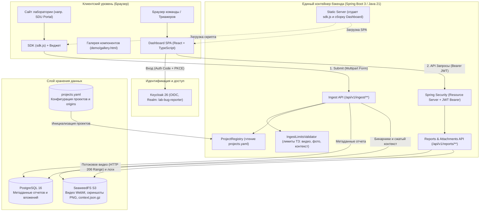
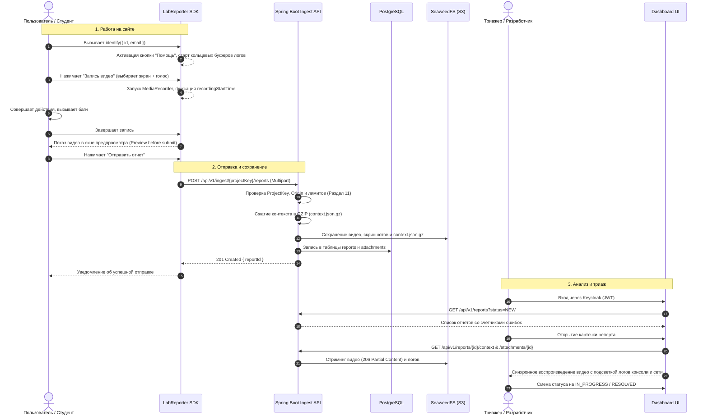

# Lab Bug Reporter

> **Self-hosted платформа сбора и триажа баг-репортов для веб-сервисов и исследовательских лабораторий.**  
> Включает легковесный встраиваемый **SDK** (запись экрана с микрофоном, скриншоты, перехват консоли/сети/действий), единый **Ingest & Dashboard API** на Spring Boot, объектное хранилище **SeaweedFS S3**, авторизацию **Keycloak (OIDC/RBAC)** и аналитический **Дашборд** с интерактивным видеоплеером и синхронизацией логов в стиле *Jam.dev*.

---

## Содержание
1. [Обзор и назначение](#обзор-и-назначение)
2. [Архитектура системы](#архитектура-системы)
3. [Стек технологий](#стек-технологий)
4. [Принцип работы (End-to-End Workflow)](#принцип-работы-end-to-end-workflow)
5. [Сбор контекста и безопасность](#сбор-контекста-и-безопасность)
6. [Комплект компонентов SDK (Components Kit)](#комплект-компонентов-sdk-components-kit)
7. [Ролевая модель (RBAC)](#ролевая-модель-rbac)
8. [Быстрый запуск в Docker](#быстрый-запуск-в-docker)
9. [Локальная разработка](#локальная-разработка)
10. [Подключение SDK на свой сайт](#подключение-sdk-на-свой-сайт)
11. [Тестирование и верификация](#тестирование-и-верификация)

---

## Обзор и назначение

В образовательных и исследовательских лабораториях (таких как SDU AI Lab) студенты и исследователи регулярно сталкиваются с багами в интерфейсах и сервисах: падение алгоритмов, таймауты API, ошибки рендеринга. 

**Lab Bug Reporter решает ключевую проблему:** сбор исчерпывающего контекста ошибки без усилий со стороны пользователя:
* **Запись экрана со звуком микрофона:** пользователь комментирует проблему голосом (до 5 минут, с настраиваемым лимитом и предпросмотром перед отправкой).
* **Скриншоты страницы:** точный захват экрана через браузерный Screen Capture API.
* **Скрытый технический контекст:** кольцевые буферы в памяти страницы автоматически фиксируют последние события консоли, сетевые запросы (XHR и Fetch) и действия пользователя (клики, переходы, смену фокуса).
* **Jam.dev-синхронизация:** в дашборде плеер синхронизирован с таймлайном логов — при воспроизведении видео лог подсвечивает точные события, происходившие в эту секунду.
* **Полный Self-Hosted:** никаких сторонних облаков (Sentry, LogRocket, Jam.dev). Все данные, видео и базы остаются внутри инфраструктуры организации.

---

## Архитектура системы

### Общая компонентная диаграмма

Система спроектирована по монолитной сервис-ориентированной архитектуре (единый масштабируемый бэкенд без лишнего оверхеда микросервисов):



### Диаграмма последовательности: Жизненный цикл отчета



---

## Стек технологий

| Область | Технология | Назначение в проекте |
|---|---|---|
| **SDK** | `TypeScript`, `Vite` | Сборка единого компактного бандла `sdk.js` (106 КБ) в формате IIFE без внешних рантайм-зависимостей. |
| **Медиа API** | `Screen Capture API`, `MediaRecorder`, `Web Audio API` | Попиксельный захват экрана, микширование звука системы и микрофона в единый WebM-поток с фиксацией времени. |
| **Дизайн SDK** | `CSS Tokens (campus.codes)` | Стили виджета изолированы, адаптивны, поддерживают светлую и темную темы, не конфликтуют со стилями хост-сайта. |
| **Dashboard** | `React 18`, `TypeScript`, `Vite` | SPA-дашборд команды: списки, фильтры, детальный просмотр, Jam.dev-плеер, табы логов. |
| **Backend** | `Java 21`, `Spring Boot 3.4` | Высокопроизводительное API: валидация, транзакции, отдача статики, потоковый Range-стриминг видео. |
| **Безопасность** | `Spring Security`, `Keycloak 26` | OAuth2 Resource Server, аутентификация через JWT Bearer токены, OIDC + PKCE, RBAC. |
| **База данных** | `PostgreSQL 16`, `Flyway` | Надежное реляционное хранение метаданных отчетов и файлов с версионируемыми миграциями. |
| **Объектное хранилище** | `SeaweedFS (S3-совместимый)` | Быстрое распределенное хранение видео, скриншотов и сжатых дампов логов. |
| **Контейнеризация** | `Docker`, `Docker Compose` | Полная оркестрация 5 сервисов одной командой, многоэтапный `Dockerfile` сборки. |
| **Тестирование** | `JUnit 5`, `Testcontainers` | Интеграционные тесты Spring Boot с реальными временными контейнерами Postgres и S3. |

---

## Принцип работы (End-to-End Workflow)

### 1. Как работает SDK на стороне сайта
* **Инициализация:** При вызове `LabReporter.init({ projectKey: "..." })` подключаются перехватчики:
  * `ConsoleCapture`: перехватывает `console.log`, `info`, `warn`, `error` и глобальные события ошибок `window.onerror` / `unhandledrejection`.
  * `NetworkCapture`: оборачивает вызовы `window.fetch` и `XMLHttpRequest`. Засекает время старта, длительность, статус ответа и тело.
  * `BreadcrumbsCapture`: собирает клики (CSS-селектор элемента и текст) и смену фокуса. **Никакой ввод текста с клавиатуры не логируется!**
* **Запись экрана со звуком:**
  * Браузер запрашивает захват экрана (`getDisplayMedia`) и доступ к микрофону (`getUserMedia`).
  * Через `AudioContext` системный звук вкладки объединяется с голосом пользователя в единый трек.
  * Виджет сворачивается в компактный плавающий индикатор с таймером вверху экрана.
  * При завершении записи видео мгновенно подставляется во встроенный плеер формы для проверки.
* **Отправка (Submit):**
  * SDK формирует единый `multipart/form-data` запрос:
    * `report` — JSON с метаданными, данными пользователя и окружением.
    * `context` — `context.json` с массивами консоли, сети и действий.
    * `screenshots` — бинарные файлы скриншотов PNG (до 5 шт).
    * `video` — бинарный файл записи WebM.
  * Отображается шкала прогресса загрузки в процентах.

### 2. Как работает Бэкенд
* **Ingest API:**
  * Проверяет существование ключа проекта `projectKey` и разрешен ли `Origin` источника по `projects.yaml`.
  * Валидирует размеры файлов (скриншоты $\le$ 10 МБ, видео $\le$ 200 МБ / 300 сек, сжатый контекст $\le$ 5 МБ).
  * Сжимает `context.json` алгоритмом GZIP в `context.json.gz`.
  * Загружает бинарные объекты в бакет S3.
  * Создает транзакционную запись в таблице `reports` и метаданные в `attachments`.
* **Потоковая отдача видео (HTTP Range Requests):**
  * Эндпоинт `/api/v1/reports/{id}/attachments/{attachId}` поддерживает заголовок `Range: bytes=start-end`.
  * Отдает статус `206 Partial Content`, что позволяет видеоплееру мгновенно перематывать даже тяжелые видеозаписи без полной предзагрузки.

### 3. Как работает Дашборд и Jam.dev синхронизация
* При открытии карточки отчета загружается видеозапись и распаковывается `context.json.gz`.
* Поскольку SDK сохраняет точное абсолютное время старта записи (`recordingStartTime`), относительное время каждого сетевого запроса и лога пересчитывается в таймлайн видео:
  * Если запрос произошел на 4-й секунде записи — при перемотке видео на 00:04 этот запрос подсвечивается в таблице сети.
  * События, произошедшие до старта записи видео, помечаются отрицательным таймингом (например, `-00:12`).

---

## Сбор контекста и безопасность

По разделу 5 ТЗ система реализует лаконичные, но надежные правила безопасности:

1. **Zero Pre-upload:** До нажатия кнопки «Отправить» ни один байт данных не покидает браузер клиента. Все логи хранятся исключительно в оперативной памяти страницы в кольцевых буферах (`RingBuffer`).
2. **Строгая маскировка заголовков авторизации (Redaction):** Значения заголовков `Authorization`, `Cookie` и `Set-Cookie` безусловно заменяются на `[REDACTED]`. Никакие действующие токены и сессии пользователей не попадают в логи и базу данных.
3. **Защита от XSS (Plain-text Rendering):** Логи консоли, сетевые тела ответов и URL могут содержать вредоносный код. В React-дашборде они выводятся строго как экранированный текст (`dangerouslySetInnerHTML` полностью исключен).
4. **Изоляция вложений:** Скачивание файлов защищено ролевой моделью Keycloak. При отдаче браузеру устанавливается заголовок `Content-Security-Policy: sandbox`, предотвращающий запуск вредоносных скриптов из вложенных SVG/HTML.
5. **Приватность ввода:** Breadcrumbs полностью игнорируют события нажатия клавиш (`keydown`, `keypress`), а при смене фокуса фиксируется только факт взаимодействия с полем, но не введенный текст. Парольные поля игнорируются полностью.

---

## Комплект компонентов SDK (Components Kit)

По Разделу 9 ТЗ SDK предоставляет возможность использовать компоненты по отдельности в интерфейсе хост-сайта:

```javascript
// Доступ к фабричным методам или классам компонентов:
const recordBtn = LabReporter.createRecordButton({
  label: "Записать проблему",
  onRecordingComplete: (result) => console.log("Видео готово:", result)
});
document.getElementById("custom-toolbar").appendChild(recordBtn.getElement());
```

Доступные компоненты (`sdk/src/widget/components/`):
* `HelpButton`: кнопка вызова репортера.
* `TypeSelector`: сегментированный переключатель (Баг, Предложение, Вопрос).
* `ReportForm`: изолированная форма ввода с полями названия и описания.
* `ScreenshotButton`: кнопка быстрого снимка экрана.
* `RecordButton`: кнопка старта/остановки записи с индикацией микрофона.
* `AttachmentList`: список прикрепленных файлов с возможностью удаления.
* `SubmitBar`: кнопка отправки с индикатором прогресса и обработкой повтора при сбое.

> Оценить работу всех компонентов вживую можно на витрине: `http://localhost:5500/demo/gallery.html`.

---

## Ролевая модель (RBAC)

Аутентификация в дашборде осуществляется через Keycloak. Права пользователей разграничиваются на уровне Spring Security:

| Роль | Доступ к проектам | Просмотр отчетов | Смена статусов (Триаж) | Удаление отчетов |
|:---:|:---|:---:|:---:|:---:|
| **`admin`** | Все проекты без ограничений | Да | Да | Да |
| **`triager`** | Только проекты, указанные в `access` группы | Да | Да | Нет |
| **`viewer`** | Только проекты, указанные в `access` группы | Да | Нет | Нет |

---

## Быстрый запуск в Docker

Для запуска всего стека требуется только установленный **Docker** и **Docker Desktop**:

```bash
# 1. Клонируйте репозиторий
git clone https://github.com/alikhan-kai/lab-bug-reporter.git
cd lab-bug-reporter

# 2. Создайте файл окружения на основе примера
cp .env.example .env

# 3. Соберите и поднимите весь стек
docker compose up -d --build
```

### Сервисы и точки входа:

| Сервис | Адрес | Описание / Учетные данные |
|---|---|---|
| **Dashboard** | [http://localhost:8080](http://localhost:8080) | Веб-интерфейс триажа отчетов команды |
| **Demo Portal** | [http://localhost:5500/demo/](http://localhost:5500/demo/) | Демо-портал студента с подключенным виджетом |
| **Components Gallery**| [http://localhost:5500/demo/gallery.html](http://localhost:5500/demo/gallery.html) | Интерактивная витрина независимых компонентов SDK |
| **SDK Script** | [http://localhost:8080/sdk.js](http://localhost:8080/sdk.js) | Скрипт SDK для встраивания на внешние сайты |
| **Keycloak SSO** | [http://localhost:8081](http://localhost:8081) | Сервер аутентификации (realm: `lab-bug-reporter`) |
| **Swagger UI** | [http://localhost:8080/swagger-ui/index.html](http://localhost:8080/swagger-ui/index.html) | Интерактивная спецификация OpenAPI 3.0 |
| **PostgreSQL** | `localhost:5432` | БД (`reporter` / `reporter_dev`) |
| **SeaweedFS S3** | `localhost:8333` | S3 API хранилища файлов |

#### Тестовые учетные записи (Dev Realm):
* **Администратор:** логин `admin` / пароль `admin`
* **Триажер:** логин `triager` / пароль `triager`
* **Наблюдатель:** логин `viewer` / пароль `viewer`
* **Пользователь демо-сайта:** Алиса Серикова (`alice` / `alice123`)

---

## Локальная разработка

Если необходимо модифицировать код компонентов без пересборки контейнеров:

```bash
# 1. Запуск инфраструктурных сервисов
docker compose up -d postgres seaweedfs keycloak

# 2. Сборка и запуск SDK в режиме watch
cd sdk
npm install
npm run build # или npm run dev

# 3. Запуск Backend (Java 21 / Maven)
cd ../server
mvn spring-boot:run

# 4. Запуск Dashboard (React / Vite)
cd ../dashboard
npm install
npm run dev # Доступен на http://localhost:3000

# 5. Запуск Demo сайта
cd ..
npx serve -l 5500 . # Доступен на http://localhost:5500/demo/
```

---

## Подключение SDK на свой сайт

Вставьте вызов скрипта в тег `<head>` вашего веб-приложения:

```html
<!-- 1. Подключение скрипта SDK -->
<script src="http://localhost:8080/sdk.js"></script>

<script>
  // 2. Инициализация параметров проекта
  LabReporter.init({
    projectKey: "pk_sdu_portal_2026",
    appVersion: "2.15.0",
    theme: "light",             // "light" | "dark" | "system"
    lang: "ru",                  // "ru" | "kk" | "en"
    maxRecordingSeconds: 300,    // лимит записи (по умолчанию 5 мин)
    apiUrl: "http://localhost:8080"
  });

  // 3. Идентификация пользователя (вызывается после успешного входа)
  // Кнопка "Помощь" появится на странице сразу после этого вызова
  LabReporter.identify({
    id: "student-10492",
    email: "student@sdu.edu.kz"
  });

  // 4. Опционально: передача контекстных метаданных
  LabReporter.setContext("faculty", "Engineering & Natural Sciences");
  LabReporter.setContext("semester", "Fall 2026");
</script>
```

---

## Тестирование и верификация

### Запуск модульных и интеграционных тестов бэкенда:
В проекте реализованы полноценные интеграционные тесты с использованием **Testcontainers**:
```bash
cd server
mvn test
```
*Запускает изолированные временные контейнеры PostgreSQL и S3 в Docker, прогоняя 58 автоматических тестов API, прав доступа, загрузки файлов и фильтрации.*

### Сценарий ручной проверки на демо-портале:
1. Перейдите на [http://localhost:5500/demo/](http://localhost:5500/demo/).
2. Нажмите **«Войти»** (активируется профиль студента Алисы Сериковой и появится кнопка «Помощь»).
3. Спровоцируйте типовые неполадки:
   * **«Загрузить решение»** — вызывает ошибку сервера 500.
   * **«Обновить расписание»** — запускает зависающий запрос (`pending`).
   * **«Синхронизировать календарь»** — падает с сетевой ошибкой сети / CORS.
   * **«Оплатить»** — пишет `PaymentGatewayException` в консоль.
4. Нажмите **«Помощь»** в правом нижнем углу.
5. Сделайте скриншот или запишите 10 секунд экрана со звуком.
6. Отправьте репорт и откройте [http://localhost:8080](http://localhost:8080) — убедитесь в наличии отчета, воспроизведении видео и точной подсветке вызванных ошибок на таймлайне!
