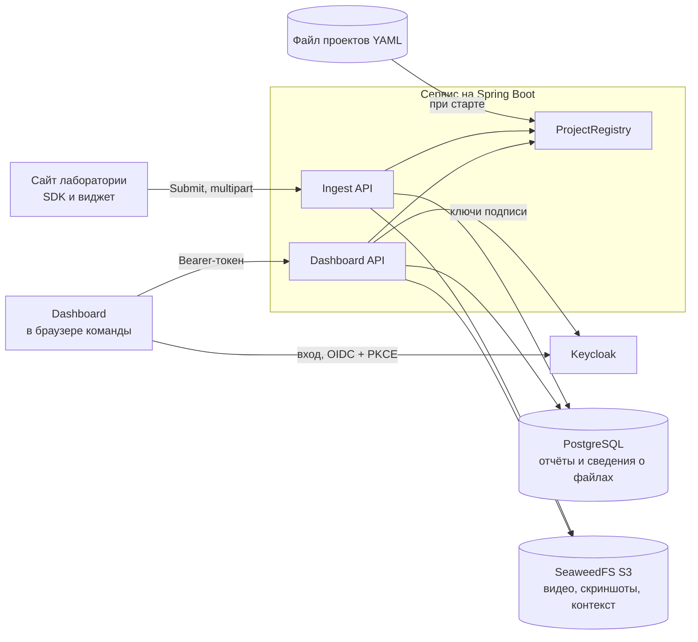

# Архитектура

Описано текущее состояние кода. Что ещё не сделано, смотрите в [roadmap.md](roadmap.md).

## Общая схема

Проект состоит из SDK внутри каждого сайта и одного сервиса, который делает всё остальное. Внутри сервиса модули
одного процесса, а не микросервисы.



## Где какие данные

| Данные | Хранилище | Класс или объект |
|---|---|---|
| Заголовок, тип, статус, URL, пользователь, окружение, метаданные сайта, счётчики ошибок console и упавших запросов | Postgres, `reports` | `Report` |
| Тип файла, размер, длительность, время старта записи, путь в S3 | Postgres, `attachments` | `Attachment` |
| Скриншоты, видео | S3, `<project>/<report-id>/<attachment-id>` | `ObjectStorage` |
| Console, network, действия пользователя | S3, `<project>/<report-id>/context.json.gz` | `ObjectStorage` |
| Проекты | YAML-файл, при старте копируются в память | `ProjectRegistry` |

Проекты намеренно не в базе (ТЗ, разделы 6 и 12): чтобы добавить сайт, правят файл и перезапускают сервис.

Личность пользователя присылает сайт, сервер хранит её как есть и считает непроверенной.

Счётчики `console_error_count` и `failed_request_count` сервер считает из контекста при приёме (`ContextCounts`):
список отчётов показывает их бейджами и не читает для этого S3. Упавший запрос это статус 4xx/5xx или запрос без
статуса, который не помечен `pending`.

## Вход в dashboard и роли

Dashboard входит через Keycloak (realm `lab-bug-reporter`, публичный клиент `lab-dashboard`, Authorization Code + PKCE)
и шлёт access-токен в заголовке `Authorization: Bearer`. Сервер проверяет подпись, срок, issuer и audience
(`lab-bug-reporter-api`, его добавляет mapper клиента). Сессий и cookie нет, поэтому CSRF выключен.

`TokenUserConverter` читает роли realm из `realm_access.roles` и превращает токен в `CurrentUser`:

| Роль dashboard | Роли Keycloak по умолчанию | Что может |
|---|---|---|
| `admin` | `admin` | Видит все проекты, меняет статус, удаляет отчёты |
| `triager` | `triager` | Видит свои проекты, меняет статус |
| `viewer` | `viewer` | Только читает свои проекты |

Какой проект виден пользователю, решает `ProjectAccessService`: admin видит все, остальные только те, в поле `access`
которых есть одна из их ролей Keycloak. Проект без `access` виден только admin.

Правила в `SecurityConfig`:

| Запрос | Кому разрешён |
|---|---|
| `/api/v1/ingest/**` | всем, защищён ключом проекта и `Origin` |
| `PATCH /api/v1/reports/**` | triager, admin |
| `DELETE /api/v1/reports/**` | admin |
| остальное под `/api/**` | любая роль dashboard |
| всё вне `/api` | всем: `sdk.js` и статика dashboard |

Без токена или с плохим токеном ответ 401, без нужной роли 403, оба в общем JSON-формате ошибок
(`JsonSecurityErrorHandler`). Отчёт из невидимого проекта отдаёт 404: это проверяет `ReportService`, роль проверяется
раньше, поэтому viewer получает 403 на `PATCH` даже для чужого отчёта.

## Как проходит отправка отчёта

1. `IngestCorsFilter` берёт ключ проекта из URL. Для разрешённого `Origin` добавляет CORS-заголовок и сам отвечает
   на preflight.
2. `IngestController` принимает multipart и через `@Valid` проверяет `ReportPayload`.
3. `IngestService` выполняет основную работу:

| Шаг | Ошибка |
|---|---|
| Найти проект по ключу | 404 |
| Проверить `Origin` | 403 |
| Проверить количество, размер и тип файлов (`IngestLimitsValidator`) | 413 или 400 |
| Проверить, что контекст это JSON, и сжать его в gzip | 400, либо 413 при превышении лимита |
| Сгенерировать `UUID` отчёта, он нужен для путей в S3 | |
| Загрузить контекст и файлы в S3 | 503 |
| Сохранить `Report` вместе с `Attachment` | 500 |
| Вернуть `{ "reportId": "..." }` со статусом 201 | |

Сначала выполняется запись в S3, затем в базу, поэтому отчёта без файлов в базе не будет. Если шаг падает,
уже загруженные объекты удаляются.

`Report` реализует `Persistable`, потому что id задаётся вручную. Запись считается новой, пока `createdAt` пуст:
это поле заполняет JPA Auditing при сохранении.

## API

### Отправка отчёта

`POST /api/v1/ingest/{projectKey}/reports`, тип `multipart/form-data`. Заголовок `Origin` обязателен.

| Часть | Обязательна | Содержимое |
|---|---|---|
| `report` | да | JSON, см. ниже |
| `context` | да | JSON-файл: `{ console, network, breadcrumbs }` |
| `screenshots` | нет | Изображения, до 5 штук |
| `video` | нет | Видео |

```json
{
  "type": "bug",
  "title": "Кнопка загрузки не работает",
  "description": "Выбираю файл, ничего не происходит",
  "pageUrl": "http://localhost:5500/demo/",
  "reporter": { "id": "u-1842", "email": "alice@lab.example" },
  "environment": { "browser": "Chrome 141" },
  "hostMetadata": { "app_version": "2.14.1" },
  "videoDurationMs": 5524,
  "recordingStartTime": 1730801640120
}
```

`type` принимает `bug`, `feature` или `question`. В `reporter` нужен `id` или `email`, иначе ответ 400.

### Ошибки

У всех ошибок один формат:

```json
{ "status": 413, "error": "Content Too Large", "message": "A video can be at most 200 MB" }
```

| Код | Когда |
|---|---|
| 400 | Некорректные данные или нет пользователя |
| 403 | `Origin` не разрешён для проекта |
| 404 | Неизвестный ключ проекта, или отчёт не найден либо не виден пользователю |
| 413 | Превышен лимит |
| 416 | `Range` вне файла |
| 503 | S3 недоступен |

### Текущий пользователь

`GET /api/v1/me`, нужен Bearer-токен с ролью dashboard.

```json
{
  "id": "5b0c…",
  "username": "triager",
  "email": "triager@lab.example",
  "roles": ["triager"],
  "projects": [{ "slug": "demo", "name": "Demo website" }]
}
```

Роли идут от сильной к слабой. Ключи проектов в ответ не попадают.

| Код | Когда |
|---|---|
| 401 | Нет токена, токен просрочен или не прошёл проверку |
| 403 | В токене нет ни одной роли dashboard |

### Отчёты для dashboard

Все запросы с Bearer-токеном. Отчёт или файл из проекта, который пользователю не виден, отдаёт 404.

| Запрос | Кто | Ответ |
|---|---|---|
| `GET /api/v1/reports` | любая роль | Страница `ReportSummaryResponse` |
| `GET /api/v1/reports/{id}` | любая роль | `ReportDetailResponse` |
| `GET /api/v1/reports/{id}/context` | любая роль | JSON `{ console, network, breadcrumbs }` в том виде, как его прислал SDK |
| `GET /api/v1/reports/{id}/attachments/{attachmentId}` | любая роль | Файл, поддерживает `Range` |
| `PATCH /api/v1/reports/{id}` | triager, admin | `{ "status": "resolved" }`, в ответ `ReportDetailResponse` |
| `DELETE /api/v1/reports/{id}` | admin | 204, удаляет запись, затем файлы и контекст в S3 |

Параметры списка: `project` (slug), `status` (`new`, `in_progress`, `resolved`, `wont_fix`), `type` (`bug`, `feature`,
`question`), `q` (поиск без учёта регистра по заголовку и описанию), `page` (с 0) и `size` (по умолчанию 20, не больше
100). Сортировка всегда от новых к старым. Без `project` ищется во всех видимых проектах.

```json
{
  "content": [{
    "id": "5b0c…", "projectSlug": "demo", "projectName": "Demo website",
    "type": "bug", "title": "Кнопка загрузки не работает", "status": "new",
    "pageUrl": "http://localhost:5500/demo/", "reporter": { "id": "u-1842", "email": "alice@lab.example" },
    "hasVideo": true, "screenshotCount": 1, "consoleErrorCount": 2, "failedRequestCount": 1,
    "createdAt": "2026-11-10T09:00:00Z"
  }],
  "page": 0, "size": 20, "totalElements": 1, "totalPages": 1
}
```

Карточка добавляет `description`, `environment`, `hostMetadata`, `attachments` (`id`, `kind`, `contentType`,
`sizeBytes`, `durationMs`, `recordingStartTime`), `recordingStartTime` видео и `updatedAt`.

Файл отдаётся целиком или по одному диапазону из `Range` (206 с `Content-Range`). Диапазон вне файла отдаёт 416.
Файлы присылают пользователи сайтов, поэтому ответ идёт с `Content-Security-Policy: sandbox`: загруженный SVG не
выполнит скрипт на origin dashboard. `` и `<video>` не умеют слать токен, поэтому dashboard скачивает файл через
API-клиент и показывает его по blob-URL.

## Лимиты

| Что | Значение | Настройка |
|---|---|---|
| Длительность видео | 300 с (плюс запас 5 с) | `MAX_VIDEO_SECONDS` |
| Размер видео | 200 МБ | `MAX_VIDEO_MB` |
| Скриншот | 10 МБ, до 5 штук | `app.ingest` в `application.yaml` |
| Контекст после сжатия | 5 МБ | `MAX_CONTEXT_MB` |

`spring.servlet.multipart.max-file-size` тоже равен 200 МБ. Если поднимаете `MAX_VIDEO_MB`, меняйте и его.

## Настройки сервера

| Переменная | По умолчанию | Назначение |
|---|---|---|
| `POSTGRES_DB`, `POSTGRES_USER`, `POSTGRES_PASSWORD` | нет | Подключение к базе на `localhost:5432` |
| `S3_ACCESS_KEY`, `S3_SECRET_KEY` | нет | Доступ к S3 |
| `S3_ENDPOINT` | `http://localhost:8333` | Адрес S3 |
| `S3_BUCKET` | `reports` | Бакет, создаётся при старте |
| `S3_REGION` | `us-east-1` | Регион |
| `S3_FORCE_PATH_STYLE` | `true` | Нужен для SeaweedFS |
| `PROJECTS_FILE` | `classpath:projects-dev.yaml` | Файл проектов. Путь на диске указывается с префиксом `file:` |
| `OIDC_ISSUER` | `http://localhost:8081/realms/lab-bug-reporter` | Issuer токенов, должен совпадать с `iss` |
| `OIDC_JWK_SET_URI` | `${OIDC_ISSUER}/protocol/openid-connect/certs` | Откуда брать ключи подписи. Отдельно, чтобы в Docker ходить к Keycloak по внутреннему адресу |
| `OIDC_AUDIENCE` | `lab-bug-reporter-api` | Обязательное значение в `aud` |
| `ADMIN_ROLES`, `TRIAGER_ROLES`, `VIEWER_ROLES` | `admin`, `triager`, `viewer` | Роли Keycloak для каждой роли dashboard, через запятую |

Dashboard настраивается переменными Vite: `VITE_KEYCLOAK_URL` (`http://localhost:8081`), `VITE_KEYCLOAK_REALM`,
`VITE_KEYCLOAK_CLIENT_ID`, `VITE_API_BASE_URL` (`/api/v1`). В dev-режиме Vite проксирует `/api` на `API_PROXY_TARGET`
(`http://localhost:8080`), поэтому dashboard и API работают с одного origin, как в контейнере.

Запись в файле проектов:

```yaml
projects:
  - slug: datasets
    name: Datasets portal
    key: pk_datasets_3f9a                                # публичный, вставляется в HTML сайта
    allowed_origins: ["https://datasets.lab.example"]
    access: [team-datasets]                              # роли Keycloak, которым виден проект
```

## Структура репозитория

```text
server/src/main/java/com/alimberdi/server/
  ingest/      приём отчётов: контроллер, сервис, CORS-фильтр, лимиты
  report/      сущности Report и Attachment, DTO, репозиторий, API отчётов для dashboard
  project/     Project, ProjectRegistry и доступ к проектам
  security/    проверка токенов Keycloak, роли, CurrentUser
  user/        GET /api/v1/me
  storage/     клиент S3 и ObjectStorage
  exception/   исключения и единый формат ошибок
  config/      JPA Auditing и разбор status/type в параметрах запроса
server/src/main/resources/
  application.yaml      настройки
  projects-dev.yaml     проекты для разработки, ключи не для продакшена
  db/migration/         миграции Flyway

sdk/src/
  index.ts              публичный API: init, identify, submitReport и другие
  core/                 буферы, перехват console и network, окружение, маскировка
  core/capture/         скриншот и запись экрана
  widget/               кнопка и боковая панель в Shadow DOM

dashboard/src/
  auth/                 вход через Keycloak и текущий пользователь
  api/                  единый API-клиент и типы ответов сервера
  hooks/                загрузка списка, отчёта и файлов
  components/           список и карточка отчёта, skeleton-заглушки
demo/                   демо-сайт index.html и галерея компонентов gallery.html
infra/seaweedfs/        ключи S3 для разработки
infra/keycloak/         dev-realm, импортируется при первом старте Keycloak
docs/                   документация
```
