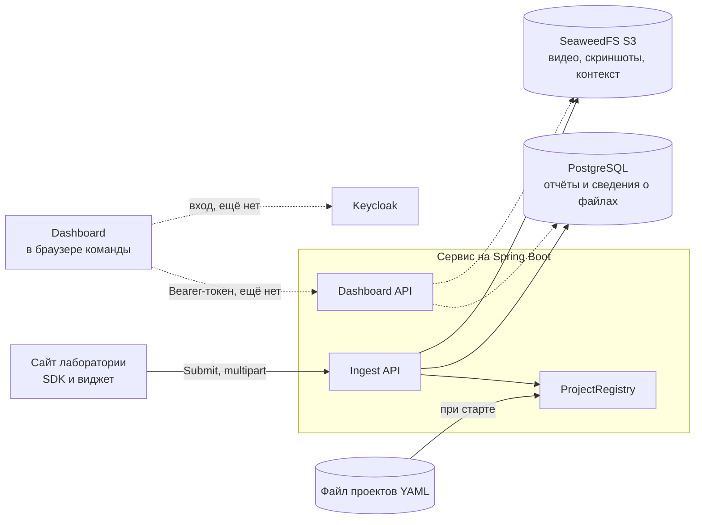

# Архитектура

Описано текущее состояние кода. Что ещё не сделано, смотрите в [roadmap.md](roadmap.md).

## Общая схема

Проект состоит из SDK внутри каждого сайта и одного сервиса, который делает всё остальное. Внутри сервиса модули
одного процесса, а не микросервисы.



Пунктир означает часть, которой пока нет.

## Где какие данные

| Данные | Хранилище | Класс или объект |
|---|---|---|
| Заголовок, тип, статус, URL, пользователь, окружение, метаданные сайта | Postgres, `reports` | `Report` |
| Тип файла, размер, длительность, время старта записи, путь в S3 | Postgres, `attachments` | `Attachment` |
| Скриншоты, видео | S3, `<project>/<report-id>/<attachment-id>` | `ObjectStorage` |
| Console, network, действия пользователя | S3, `<project>/<report-id>/context.json.gz` | `ObjectStorage` |
| Проекты | YAML-файл, при старте копируются в память | `ProjectRegistry` |

Проекты намеренно не в базе (ТЗ, разделы 6 и 12): чтобы добавить сайт, правят файл и перезапускают сервис.

Личность пользователя присылает сайт, сервер хранит её как есть и считает непроверенной.

## Как проходит отправка отчёта

1. `IngestCorsFilter` берёт ключ проекта из URL. Для разрешённого `Origin` добавляет CORS-заголовок и сам отвечает
   на preflight.
2. `IngestController` принимает multipart и через `@Valid` проверяет `ReportPayload`.
3. `IngestService` выполняет основную работу:

| Шаг | Ошибка |
|---|---|
| Найти проект по ключу | 404 |
| Проверить `Origin` | 403 |
| Проверить количество, размер и тип файлов (`IngestLimitsValidator`) | 413 или 400 |
| Проверить, что контекст это JSON, и сжать его в gzip | 400, либо 413 при превышении лимита |
| Сгенерировать `UUID` отчёта, он нужен для путей в S3 | |
| Загрузить контекст и файлы в S3 | 503 |
| Сохранить `Report` вместе с `Attachment` | 500 |
| Вернуть `{ "reportId": "..." }` со статусом 201 | |

Сначала выполняется запись в S3, затем в базу, поэтому отчёта без файлов в базе не будет. Если шаг падает,
уже загруженные объекты удаляются.

`Report` реализует `Persistable`, потому что id задаётся вручную. Запись считается новой, пока `createdAt` пуст:
это поле заполняет JPA Auditing при сохранении.

## API

### Отправка отчёта

`POST /api/v1/ingest/{projectKey}/reports`, тип `multipart/form-data`. Заголовок `Origin` обязателен.

| Часть | Обязательна | Содержимое |
|---|---|---|
| `report` | да | JSON, см. ниже |
| `context` | да | JSON-файл: `{ console, network, breadcrumbs }` |
| `screenshots` | нет | Изображения, до 5 штук |
| `video` | нет | Видео |

```json
{
  "type": "bug",
  "title": "Кнопка загрузки не работает",
  "description": "Выбираю файл, ничего не происходит",
  "pageUrl": "http://localhost:5500/demo/",
  "reporter": { "id": "u-1842", "email": "alice@lab.example" },
  "environment": { "browser": "Chrome 141" },
  "hostMetadata": { "app_version": "2.14.1" },
  "videoDurationMs": 5524,
  "recordingStartTime": 1730801640120
}
```

`type` принимает `bug`, `feature` или `question`. В `reporter` нужен `id` или `email`, иначе ответ 400.

### Ошибки

У всех ошибок один формат:

```json
{ "status": 413, "error": "Content Too Large", "message": "A video can be at most 200 MB" }
```

| Код | Когда |
|---|---|
| 400 | Некорректные данные или нет пользователя |
| 403 | `Origin` не разрешён для проекта |
| 404 | Неизвестный ключ проекта |
| 413 | Превышен лимит |
| 503 | S3 недоступен |

Эндпоинты dashboard (`/api/me`, список, карточка, контекст, файлы, статус, удаление) ещё не реализованы.

## Лимиты

| Что | Значение | Настройка |
|---|---|---|
| Длительность видео | 300 с (плюс запас 5 с) | `MAX_VIDEO_SECONDS` |
| Размер видео | 200 МБ | `MAX_VIDEO_MB` |
| Скриншот | 10 МБ, до 5 штук | `app.ingest` в `application.yaml` |
| Контекст после сжатия | 5 МБ | `MAX_CONTEXT_MB` |

`spring.servlet.multipart.max-file-size` тоже равен 200 МБ. Если поднимаете `MAX_VIDEO_MB`, меняйте и его.

## Настройки сервера

| Переменная | По умолчанию | Назначение |
|---|---|---|
| `POSTGRES_DB`, `POSTGRES_USER`, `POSTGRES_PASSWORD` | нет | Подключение к базе на `localhost:5432` |
| `S3_ACCESS_KEY`, `S3_SECRET_KEY` | нет | Доступ к S3 |
| `S3_ENDPOINT` | `http://localhost:8333` | Адрес S3 |
| `S3_BUCKET` | `reports` | Бакет, создаётся при старте |
| `S3_REGION` | `us-east-1` | Регион |
| `S3_FORCE_PATH_STYLE` | `true` | Нужен для SeaweedFS |
| `PROJECTS_FILE` | `classpath:projects-dev.yaml` | Файл проектов. Путь на диске указывается с префиксом `file:` |

Запись в файле проектов:

```yaml
projects:
  - slug: datasets
    name: Datasets portal
    key: pk_datasets_3f9a                                # публичный, вставляется в HTML сайта
    allowed_origins: ["https://datasets.lab.example"]
    access: [team-datasets]                              # роли Keycloak, которым виден проект
```

## Структура репозитория

```text
server/src/main/java/com/alimberdi/server/
  ingest/      приём отчётов: контроллер, сервис, CORS-фильтр, лимиты
  report/      сущности Report и Attachment, DTO, репозиторий
  project/     Project и ProjectRegistry
  storage/     клиент S3 и ObjectStorage
  exception/   исключения и единый формат ошибок
  config/      настройка JPA Auditing
server/src/main/resources/
  application.yaml      настройки
  projects-dev.yaml     проекты для разработки, ключи не для продакшена
  db/migration/         миграции Flyway

sdk/src/
  index.ts              публичный API: init, identify, submitReport и другие
  core/                 буферы, перехват console и network, окружение, маскировка
  core/capture/         скриншот и запись экрана
  widget/               кнопка и боковая панель в Shadow DOM

dashboard/src/          интерфейс разбора отчётов, сейчас на mockData.ts
demo/                   демо-сайт index.html и галерея компонентов gallery.html
infra/seaweedfs/        ключи S3 для разработки
infra/keycloak/         импорт realm, пока пусто
docs/                   документация
```
