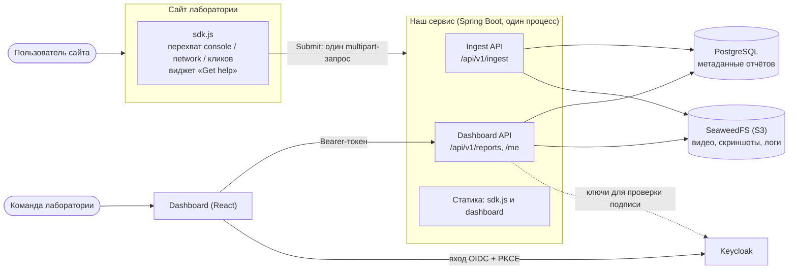

# Как устроен Lab Bug Reporter: весь проект от начала до конца

Это объяснение для человека, а не справочник. Цель: прочитать один раз и понять, что мы построили, из каких
частей оно состоит, как части разговаривают друг с другом и где в коде что лежит. Точные таблицы API и
переменных окружения остаются в [architecture.md](architecture.md).

---

## 1. Что мы сделали, в двух абзацах

Мы сделали свой аналог Jam.dev для сайтов лаборатории. На сайт вставляется один `<script>`. После того как
пользователь вошёл на сайт, в углу появляется кнопка «Get help». Пользователь описывает проблему, по желанию
делает скриншоты или записывает экран с голосом и жмёт Submit. Вместе с его текстом автоматически уходит то, что
разработчику обычно приходится выпрашивать: последние сообщения консоли, сетевые запросы (с телами и
заголовками), клики и переходы пользователя, браузер, ОС, размер окна.

Команда лаборатории открывает dashboard, входит через Keycloak и разбирает отчёты: смотрит видео, а под ним
лента событий консоли и сети, синхронизированная с видео по времени. Отчётам меняют статус (new → in progress →
resolved / won't fix), админ может удалить. Всё работает на нашей инфраструктуре: ничего не уходит в чужие
облака.



---

## 2. Из каких частей состоит

| Часть | Папка | Что это | Где работает |
|---|---|---|---|
| **SDK** | `sdk/` | TypeScript без фреймворков, собирается в один файл `sdk.js` | В браузере пользователя, внутри чужого сайта |
| **Сервер** | `server/` | Java 21, Spring Boot 4.1 | В Docker-контейнере `server`, порт 8080 |
| **Dashboard** | `dashboard/` | React 19 + TypeScript, Vite | В браузере команды; файлы отдаёт тот же сервер |
| **Демо-сайт** | `demo/`, `infra/demo/` | Страница «портал студента» и nginx с нарочно сломанными адресами | Контейнер `demo`, порт 5500 |
| **Инфраструктура** | `docker-compose*.yaml`, `Dockerfile`, `infra/` | Postgres, SeaweedFS, Keycloak, сборка образа | Docker |

Важная мысль: **сервис один**. Нет отдельного фронтенд-сервера, отдельного сервиса приёма и отдельного сервиса
API. Один Spring Boot процесс:

- принимает отчёты от SDK (`/api/v1/ingest/...`);
- отдаёт API для dashboard (`/api/v1/reports`, `/api/v1/me`, `/api/v1/dashboard-config`);
- отдаёт файл `sdk.js`, шрифты виджета (`/sdk-fonts/...`) и собранный dashboard (`/`, `index.html`, JS, CSS).

Внутри процесса код разделён на модули по фичам (`ingest`, `report`, `security`, ...), но это модули одного
приложения, а не микросервисы.

---

## 3. Путь одного отчёта: от клика до экрана команды

Это главный сценарий, всё остальное его обслуживает.

```mermaid
sequenceDiagram
    autonumber
    participant U as Пользователь
    participant Site as Сайт + sdk.js
    participant Srv as Сервер (Spring Boot)
    participant S3 as SeaweedFS (S3)
    participant DB as PostgreSQL
    participant Dash as Dashboard
    participant KC as Keycloak

    Note over Site: sdk.js загрузился в &lt;head&gt; и сразу<br/>перехватил console, fetch, XHR, клики
    Site->>Site: LabReporter.init({ projectKey })<br/>LabReporter.identify({ id, email })
    Note over Site: Кнопка «Get help» появляется только после identify
    U->>Site: Get help → тип, заголовок, описание,<br/>скриншот / запись экрана
    U->>Site: Submit
    Site->>Srv: POST /api/v1/ingest/{projectKey}/reports<br/>multipart: report, context, screenshots, video
    Srv->>Srv: ключ проекта? Origin разрешён? лимиты?<br/>context — валидный JSON? сжать в gzip
    Srv->>S3: context.json.gz, скриншоты, видео
    Srv->>DB: INSERT reports + attachments
    Srv-->>Site: 201 { reportId }
    Site-->>U: «Отправлено», номер отчёта

    Dash->>Srv: GET /api/v1/dashboard-config (без токена)
    Dash->>KC: вход (Authorization Code + PKCE)
    KC-->>Dash: access-токен (JWT)
    Dash->>Srv: GET /api/v1/me, GET /api/v1/reports (Bearer)
    Srv->>DB: отчёты видимых пользователю проектов
    Dash->>Srv: GET /reports/{id}, /context, /attachments/{id}
    Srv->>S3: прочитать контекст и файлы
    Srv-->>Dash: данные → видео + лента событий
```

По шагам, что происходит на самом деле.

### 3.1. Сайт подключает SDK

```html
<script src="https://reports.lab.example/sdk.js"></script>
<script>
  LabReporter.init({ projectKey: "pk_datasets_3f9a", appVersion: "2.14.1" });
  // после входа пользователя на сайте:
  LabReporter.identify({ id: "u-1842", email: "alice@lab.example" });
</script>
```

- `sdk.js` это IIFE-бандл: при загрузке он сам создаёт объект `window.LabReporter`.
- **Перехват начинается сразу при загрузке скрипта**, ещё до `init()`, в конструкторе класса `LabBugReporter`
  (`sdk/src/index.ts`). Поэтому скрипт ставят как можно раньше: ошибки, случившиеся до его загрузки, он не увидит.
- `projectKey` публичный, он виден в HTML. Он не секрет, а просто имя проекта для сервера. Защиту даёт проверка
  `Origin` (см. 3.4).
- Адрес сервера SDK по умолчанию берёт из адреса, откуда загружен сам `sdk.js` (`core/script-url.ts`), поэтому
  `apiUrl` обычно указывать не нужно.
- `identify()` передаёт, кто пользователь. Сервер хранит это как есть и считает **непроверенным**: сайт может
  прислать что угодно, у нас нет способа это проверить.
- Вид виджета каждый сайт задаёт сам через `init({ appearance })` или позже `LabReporter.setAppearance()`
  (`widget/appearance.ts`): кнопка (`pill`, `icon`, `tab` или `none`, тогда форму открывает своя кнопка сайта
  через `LabReporter.open()`), её текст, акцент, сторона, углы, отступ. Неверное значение не ломает страницу:
  виджет пишет предупреждение и берёт значение по умолчанию.

### 3.2. Что SDK собирает, пока пользователь работает

Всё хранится **только в памяти вкладки** в кольцевых буферах (`core/ring-buffer.ts`): у буфера есть максимум
записей и максимальный возраст записи (5 минут). Старое вытесняется, поэтому память не растёт бесконечно.

| Что | Модуль | Буфер | Как перехватывается |
|---|---|---|---|
| Консоль | `core/console.ts` | 500 записей | Подмена `console.log/info/warn/error` + события `error` и `unhandledrejection` |
| Сеть | `core/network.ts` | 200 записей | Обёртки над `window.fetch` и `XMLHttpRequest.prototype.open/send/setRequestHeader` |
| Действия | `core/breadcrumbs.ts` | 100 записей | Слушатели `click`, `focusin`, `popstate`, `hashchange` |
| Окружение | `core/environment.ts` | — | Читается в момент отправки: URL, user agent, браузер, ОС, viewport, язык, часовой пояс |

Правила из ТЗ, которые SDK соблюдает и которые нельзя ломать:

1. **Ничего не уходит до Submit.** Буферы живут в памяти, сетевых запросов SDK не делает, кроме загрузки
   шрифта и самой отправки.
2. **SDK никогда не ломает сайт.** Каждая обёртка зовёт оригинал и возвращает его результат. Запись в лог
   обёрнута в `try/catch`: если сломалась запись в лог, запрос сайта всё равно проходит. Пример из
   `core/network.ts`:

   ```ts
   window.fetch = async function (...args) {
     let capture;
     try {
       capture = self.startFetchCapture(args);
     } catch {
       capture = null;            // лог пропустит этот запрос, но сайт получит ответ
     }
     if (!capture) {
       return originalFetch.apply(window, args);
     }
     ...
     response = await originalFetch.apply(window, args);   // ошибка сайта пробрасывается сайту как есть
     ...
     const clone = response.clone();                       // тело читаем из копии, сайту отдаём оригинал
   ```

3. **Свой запрос не попадает в лог.** Обёртки пропускают URL, содержащий путь ingest
   (`setIngestEndpoint` в `network.ts`). Иначе в каждом отчёте был бы запрос отправки самого отчёта.
4. **Маскируются только `Authorization`, `Cookie`, `Set-Cookie`** (`core/redact.ts`): их значения заменяются на
   `[REDACTED]`. Других правил маскировки нет, это решение из ТЗ. Тела запросов обрезаются до 64 КБ, строки
   консоли до 4 КБ.
5. **Зависшие запросы тоже видны.** Запрос сразу кладётся в `inFlightRequests` с `pending: true`. Если на
   момент Submit ответа нет, он уйдёт в отчёт как «висящий» с текущей длительностью.
6. **У упавшего запроса `status` пустой (`null`)**, а причина в `error`. Так «сеть упала» отличается от «сервер
   ответил 500».

Пароли не собираются: у клика по `input[type=password]` текст не берётся, а при `focusin` записывается только
тег и id поля, не его содержимое.

### 3.3. Скриншот и запись экрана

- Скриншот (`core/capture/screenshot.ts`): `getDisplayMedia` → один кадр в `<canvas>` → PNG. Поток сразу
  останавливается. До 5 скриншотов на отчёт.
- Запись (`core/capture/recorder.ts`): `getDisplayMedia` (экран + звук вкладки), по желанию `getUserMedia`
  (микрофон). Два звука смешиваются через Web Audio (`AudioContext`) в одну дорожку. `MediaRecorder` пишет
  WebM (`vp8,opus`).
- **`startTime` (время старта записи)** это якорь для синхронизации. Каждое событие консоли и сети имеет свою
  метку времени `Date.now()`. Dashboard вычитает из неё `recordingStartTime` и получает «на какой секунде видео
  это случилось». События до начала записи показываются с минусом.
- Лимит по умолчанию 5 минут (`init({ maxRecordingSeconds })`): запись сама останавливается, за 30 секунд
  виджет предупреждает. Перед отправкой запись можно посмотреть прямо в форме. Если пользователь нажал
  «Закрыть доступ» в панели Chrome, запись тоже корректно останавливается и остаётся в отчёте.

### 3.4. Отправка (Submit)

`submitReport()` в `sdk/src/index.ts` собирает `FormData` из четырёх частей:

| Часть | Что внутри |
|---|---|
| `report` | JSON: тип, заголовок, описание, URL страницы, пользователь, окружение, метаданные сайта, длительность видео и время старта записи |
| `context` | JSON-файл `{ console, network, breadcrumbs }`: всё, что собрали буферы |
| `screenshots` | 0–5 PNG |
| `video` | 0–1 WebM |

Отправляется **через XHR, а не fetch** (`core/upload.ts`): только XHR умеет сообщать прогресс загрузки
(`upload.onprogress`), а он нужен для полоски прогресса в виджете. Ошибка показывается в форме с кнопкой Retry,
введённый текст и вложения не теряются.

### 3.5. Сервер принимает отчёт

Коротко:

1. `IngestCorsFilter` по ключу из URL находит проект и, если `Origin` разрешён, добавляет CORS-заголовок. Он же
   отвечает на preflight (`OPTIONS`).
2. `IngestController` разбирает multipart и валидирует JSON `report` (`@Valid`).
3. `IngestService`:
   - проект по ключу не найден → **404**;
   - `Origin` не в `allowed_origins` → **403**;
   - больше 5 скриншотов, файл больше лимита, видео длиннее 5 минут → **413**; не тот тип файла → **400**;
   - `context` не JSON → **400**; считает число ошибок консоли и упавших запросов (для бейджей списка);
     сжимает контекст в gzip, проверяет лимит 5 МБ;
   - генерирует `UUID` отчёта, кладёт в S3 `demo/<reportId>/context.json.gz` и файлы `demo/<reportId>/<attachmentId>`;
   - сохраняет `Report` и `Attachment` в Postgres;
   - если что-то упало после начала записи в S3, удаляет уже загруженные объекты.
4. Ответ `201 { "reportId": "..." }`.

### 3.6. Команда разбирает отчёт в dashboard

1. Dashboard грузится с того же адреса, что и API, и первым делом зовёт публичный
   `GET /api/v1/dashboard-config`, чтобы узнать, где Keycloak. Так один собранный образ работает на любом домене.
2. `keycloak-js` перенаправляет на страницу входа Keycloak (Authorization Code + PKCE). После входа у dashboard
   есть access-токен (JWT), он обновляется сам за 30 секунд до истечения.
3. `GET /api/v1/me` возвращает пользователя, его роли и видимые проекты. По ролям dashboard прячет кнопки
   (смена статуса, удаление). Сервер те же правила проверяет сам: прятать кнопку недостаточно.
4. Список (`GET /api/v1/reports`) с фильтрами по проекту, статусу, типу, поиском и страницами по 20. По умолчанию
   показываются статусы `new`. Сортировка «для разбора»: сначала `new`, потом `in_progress`, `resolved`,
   `wont_fix`, внутри статуса от новых к старым. Над списком счётчики по статусам
   (`GET /api/v1/reports/status-counts`, учитывает проект, тип и поиск, но не статус), по ним же фильтруют;
   отчёты сгруппированы по дням.
5. Карточка отчёта параллельно грузит `GET /reports/{id}` и `GET /reports/{id}/context`. Видео и скриншоты
   скачиваются через API-клиент в `Blob` и показываются по `blob:`-URL, потому что `` и `<video>` не
   умеют отправлять заголовок `Authorization`.
6. Под видео шкала событий (`EventTrace`), ниже вкладки Network, Console, Actions. Клик по событию на шкале или
   в списке перематывает видео на его момент.

---

## 4. Где какие данные хранятся

| Данные | Где | Почему там |
|---|---|---|
| Заголовок, описание, тип, статус, URL, пользователь, окружение (JSONB), метаданные сайта (JSONB), счётчики ошибок, время создания и изменения | Postgres, таблица `reports` | Это то, по чему ищут и фильтруют |
| Тип файла, размер, длительность, время старта записи, ключ в S3 | Postgres, таблица `attachments` | Чтобы показать список вложений без похода в S3 |
| Видео, скриншоты | S3: `<projectSlug>/<reportId>/<attachmentId>` | Большие бинарные файлы не место базе; ТЗ запрещает хранить их на диске контейнера |
| Console, network, breadcrumbs | S3: `<projectSlug>/<reportId>/context.json.gz` | Могут быть мегабайты, нужны только при открытии карточки |
| Проекты (ключ, разрешённые origin, кто видит) | YAML-файл, читается при старте в память | ТЗ: проекты задаются конфигом, не базой; нового сайта добавляют правкой файла и перезапуском |
| Пользователи команды, пароли, роли | Keycloak | Мы не храним пользователей вообще: только читаем токен |

Схема базы создаётся миграциями Flyway (`server/src/main/resources/db/migration/`), Hibernate только сверяет
её с сущностями (`ddl-auto: validate`).

---

## 5. Вход, роли и кто что видит

### Роли

| Роль | Что может |
|---|---|
| `viewer` | Читать отчёты своих проектов |
| `triager` | То же + менять статус |
| `admin` | Видит все проекты, меняет статус, удаляет отчёты |

Роли приходят из Keycloak в токене (`realm_access.roles`). Какие роли Keycloak считать `admin`, `triager`,
`viewer`, настраивается переменными `ADMIN_ROLES`, `TRIAGER_ROLES`, `VIEWER_ROLES`. Это нужно, если в настоящем
Keycloak лаборатории роли называются иначе.

### Доступ к проектам

В файле проектов у каждого проекта есть поле `access`: список ролей Keycloak, которым он виден.

```yaml
projects:
  - slug: demo
    name: Demo website
    key: pk_sdu_portal_2026
    allowed_origins: [http://localhost:5500]
    access: [team-demo]       # видят те, у кого в токене есть роль team-demo
```

Admin видит всё. Остальные видят проект, если у них есть хотя бы одна роль из `access`. Проект без `access`
видит только admin. В dev-realm пользователи `triager` и `viewer` имеют роль `team-demo`, поэтому видят `demo`, но
не `admin-only`.

### 404, а не 403

Если отчёт лежит в проекте, который пользователю не виден, сервер отвечает **404 «Report not found»**, а не 403.
Так нельзя узнать, что такой отчёт вообще существует. А 403 бывает, когда роль слабая для действия: viewer
пытается сменить статус.

### Две разные защиты на двух входах

| Вход | Кто зовёт | Чем защищён |
|---|---|---|
| `/api/v1/ingest/**` | SDK на любом сайте, анонимно | Ключ проекта в URL + проверка `Origin` + лимиты размера |
| `/api/v1/**` (остальное) | Dashboard | JWT от Keycloak: подпись, срок, issuer, audience, роль |
| `/api/v1/dashboard-config` | Dashboard до входа | Открыт: там только адрес Keycloak |
| Всё вне `/api` | Кто угодно | Открыто: `sdk.js`, шрифты, статика dashboard, Swagger |

---

## 6. Dashboard изнутри

```text
dashboard/src/
  main.tsx              точка входа: <AuthProvider><App/></AuthProvider>
  auth/
    keycloak.ts         получить dashboard-config, инициализировать keycloak-js, выдать свежий токен
    AuthProvider.tsx    вход + /me, пока грузится — skeleton, при ошибке — экран «нет доступа»
    permissions.ts      canChangeStatus, canDeleteReports (только чтобы прятать кнопки)
  api/
    client.ts           ЕДИНСТВЕННОЕ место, где делаются запросы: добавляет Bearer, разбирает ошибки
    types.ts            типы ответов сервера
  hooks/
    useReportList.ts    загрузка страницы списка по фильтрам
    useReportView.ts    загрузка карточки + контекста, загрузка медиа в blob-URL
    useStatusCounts.ts  счётчики по статусам над списком
    useReportRoute.ts   ?report=<id> в адресе, кнопка «Назад» браузера
    useTheme.ts         светлая / тёмная тема
  report/
    timeline.ts         время событий относительно видео, итог запроса (ok / failed / pending)
    groups.ts           группировка списка по дням
    trace.ts            разметка шкалы событий под видео
  components/           ReportList, ReportDetail, EventTrace, ReportLogs, ReportMedia, skeleton-заглушки ...
  styles/tokens.css     палитра светлой и тёмной темы, радиусы, шрифт Geist
```

Как устроена загрузка данных: каждый хук держит состояние в виде
`{ status: 'loading' } | { status: 'error', message } | { status: 'ready', ... }`. Компонент по `status`
рисует skeleton, ошибку с Retry или данные. Это требование из правил проекта: у каждого экрана есть loading,
empty и error.

Безопасность отображения: всё, что прислал сайт (сообщения консоли, тела запросов, URL), выводится как **текст**
через React, без `dangerouslySetInnerHTML` (его в коде нет). Ссылками становятся только `http(s)://` URL
(`isWebUrl`), поэтому `javascript:` останется текстом. Файлы с сервера приходят с
`Content-Security-Policy: sandbox`, чтобы загруженный SVG не выполнил скрипт.

Маршрутизации-библиотеки нет: открытый отчёт это просто `?report=<id>` в адресе и `history.pushState`.

---

## 7. Демо-сайт

`demo/index.html` это «портал студента» с подключённым SDK. Его nginx (`infra/demo/templates/default.conf.template`)
отдаёт страницу на своём origin (`localhost:5500`), как настоящий чужой сайт, и содержит маленький «бэкенд»,
который ломается нарочно:

| Действие на странице | Адрес | Что происходит |
|---|---|---|
| «Загрузить решение» | `/demo-api/server-error` | Ответ 500 |
| «Обновить» расписание | `/demo-api/hang` | Ответ через 10 минут (njs), в отчёте будет зависшим |
| «Синхронизировать» | несуществующий хост | Сетевая ошибка, `status: null` |
| «Оплатить» | — | `console.error` |
| «Обновить профиль» | `/demo-api/profile` | 200, но с заголовком `Authorization`, чтобы проверить маскировку |

`/demo/config.js` генерируется nginx из `PUBLIC_BASE_URL`, так страница знает, куда слать отчёты. `sdk.js`
nginx берёт у контейнера `server`, как настоящий сайт брал бы его у нашего сервиса.

---

## 8. Инфраструктура и запуск

### Docker-образ (`Dockerfile`): четыре стадии

```text
node:22   → собрать SDK          → dist/sdk.js, dist/sdk-fonts/
node:22   → собрать dashboard    → dist/ (index.html, JS, CSS)
maven     → положить оба в server/src/main/resources/static/ → mvn package → server.jar
temurin   → только JRE + jar, запуск не от root, healthcheck на /api/v1/dashboard-config
```

Spring Boot отдаёт всё из `static/` автоматически, поэтому dashboard открывается на `/`, а SDK на `/sdk.js`.
Отсюда «один образ, один порт».

### docker-compose.yaml (разработка)

| Сервис | Порт | Зачем |
|---|---|---|
| `postgres` | 5432 | База отчётов |
| `seaweedfs` | 8333 | S3-совместимое хранилище |
| `keycloak` | 8081 | Вход команды; при первом старте импортирует realm из `infra/keycloak/` |
| `server` | 8080 | Наш сервис |
| `demo` | 5500 | Демо-сайт на nginx |

Внутри Docker-сети сервер ходит к соседям по именам (`postgres`, `seaweedfs`, `keycloak`). Одна тонкость:
**issuer токена должен быть публичным адресом Keycloak** (`http://localhost:8081/...`), потому что именно его
видит браузер и он записан в токен. А ключи подписи сервер скачивает по внутреннему адресу
`http://keycloak:8080/...`. Поэтому в конфиге два отдельных параметра: `OIDC_ISSUER` и `OIDC_JWK_SET_URI`.

### docker-compose.prod.yaml (на сервере)

Накладывается поверх основного: Postgres и SeaweedFS без портов наружу; `server`, `keycloak`, `demo` слушают
только `127.0.0.1` (TLS снимает nginx хоста); Keycloak в режиме `start` с данными в Postgres; лимиты памяти,
весь стек около 2,5 ГБ; свой `projects.yaml` с настоящими origin, не в git.

### Конфигурация

Секреты и адреса только из окружения (`.env`, в git лежит пустой `.env.example`). Сервер сам читает `.env` из
корня (`spring.config.import` в `application.yaml`), поэтому из IDE он стартует без ручной настройки.

---

## 9. Как части разговаривают: сводная таблица

| Кто → кому | Адрес | Протокол | Аутентификация |
|---|---|---|---|
| Сайт → сервер (загрузка SDK) | `GET /sdk.js`, `/sdk-fonts/*` | HTTP | нет |
| SDK → сервер (отчёт) | `POST /api/v1/ingest/{key}/reports` | multipart, CORS | ключ + `Origin` |
| Dashboard → сервер (настройки входа) | `GET /api/v1/dashboard-config` | JSON | нет |
| Dashboard → Keycloak | `/realms/lab-bug-reporter/...` | OIDC, PKCE | логин и пароль пользователя |
| Dashboard → сервер (данные) | `/api/v1/me`, `/api/v1/reports/**` | JSON, Range для файлов | `Authorization: Bearer <JWT>` |
| Сервер → Keycloak | `.../protocol/openid-connect/certs` | HTTP (JWK Set) | нет, это публичные ключи |
| Сервер → Postgres | `jdbc:postgresql://postgres:5432/...` | JDBC | логин и пароль из `.env` |
| Сервер → SeaweedFS | `http://seaweedfs:8333` | S3 API (AWS SDK v2) | access/secret key из `.env` |
| Demo nginx → сервер | `http://server:8080/sdk.js` | HTTP proxy | нет |

---

## 10. Карта: куда идти, если хочешь...

| Хочу | Файл |
|---|---|
| Понять, что SDK отправляет | `sdk/src/index.ts`, метод `submitReport` |
| Поменять, что пишется о сетевом запросе | `sdk/src/core/network.ts` |
| Поменять правила маскировки (по ТЗ нельзя) | `sdk/src/core/redact.ts` |
| Поменять внешний вид виджета | `sdk/src/widget/widget.ts`, `widget/tokens.css.ts` |
| Настройки вида виджета для сайта | `sdk/src/widget/appearance.ts` |
| Отдельные компоненты для своей вёрстки | `sdk/src/widget/components/`, галерея `demo/gallery.html` |
| Тексты виджета ru/en/kk | `sdk/src/core/i18n.ts` |
| Понять приём отчёта | `server/.../ingest/IngestService.java` |
| Поменять лимиты | `server/src/main/resources/application.yaml`, блок `app.ingest` |
| Добавить сайт | файл проектов (`projects-dev.yaml` / `projects.yaml`) + перезапуск сервера |
| Поменять, кто что может | `server/.../security/SecurityConfig.java`, `project/ProjectAccessService.java` |
| Поменять фильтры или сортировку списка | `server/.../report/ReportSpecifications.java` |
| Добавить колонку в базу | новая миграция `V3__...sql` + поле в `Report.java` |
| Поменять, как dashboard ходит в API | `dashboard/src/api/client.ts` |
| Карточка отчёта, вкладки логов | `dashboard/src/components/ReportDetail.tsx`, `ReportLogs.tsx` |
| Синхронизация времени с видео | `dashboard/src/report/timeline.ts` |
| Пользователи и роли dev-окружения | `infra/keycloak/lab-bug-reporter-realm.json` |
| Нарочно сломанные адреса демо | `infra/demo/templates/default.conf.template` |

---

## 11. Что я проверил

- Прочитан весь код сервера, SDK, dashboard, Dockerfile, compose-файлы, realm Keycloak и nginx демо.
- Документация (`README.md`, `architecture.md`, `roadmap.md`) совпадает с кодом: эндпоинты, роли, лимиты,
  переменные, структура папок.
- Требования ТЗ из `AGENTS.md` в коде соблюдены: обёртки зовут оригиналы и глушат свои ошибки; свой запрос
  исключён из лога; маскируются ровно три заголовка; в dashboard нет `dangerouslySetInnerHTML`; тела отчётов в
  лог сервера не пишутся (логируются только ошибки S3 и неожиданные исключения); файлы и контекст только в S3;
  проекты из файла; чужой отчёт отдаёт 404, слабая роль 403.
- Тесты: `cd server && mvn test` (нужен только Docker), `npm test` в `sdk/` и `dashboard/`. CI в GitHub Actions
  (`.github/workflows/ci.yaml`) на каждый PR собирает SDK и dashboard и гоняет тесты сервера.

## 12. Что ещё не сделано

По [roadmap.md](roadmap.md): деплой на настоящий сервер (nginx с TLS, DNS, сертификаты), видео больше 100 МБ
(dashboard качает файл целиком до показа), перенос отдельных компонентов `LabReporter.components` на новый вид
виджета целиком. Не входят в v1 по ТЗ: расширение
браузера, транскодирование видео, исполнители и комментарии, уведомления, rate limiting, очистка старых данных,
админка, AI-функции, браузеры кроме Chrome.

---

## 13. Словарик

| Термин | Простыми словами |
|---|---|
| **SDK** | Наш скрипт `sdk.js`, который сайт вставляет к себе |
| **Ingest** | «Приём»: эндпоинт, куда SDK присылает отчёт |
| **Multipart** | Формат HTTP-запроса, в котором несколько частей: JSON и файлы в одном запросе |
| **CORS** | Правила браузера: скрипт с сайта A может читать ответ сервера B, только если B разрешил origin A заголовком `Access-Control-Allow-Origin` |
| **Origin** | Схема + домен + порт страницы, например `http://localhost:5500`. Браузер ставит его сам, скрипт его подделать не может |
| **Preflight** | Запрос `OPTIONS`, которым браузер заранее спрашивает сервер, можно ли сделать настоящий запрос |
| **Ring buffer** | Буфер фиксированного размера: новое вытесняет старое |
| **Shadow DOM** | Изолированное поддерево DOM: стили сайта не ломают виджет, стили виджета не ломают сайт |
| **S3 / SeaweedFS** | S3 это протокол хранилища файлов от Amazon. SeaweedFS это open-source сервер, который этот протокол реализует у нас |
| **Keycloak** | Сервер входа: хранит пользователей, выдаёт токены |
| **OIDC** | Стандарт входа поверх OAuth 2: как получить токен и узнать, кто пользователь |
| **PKCE** | Защита входа для публичных клиентов (SPA без секрета): одноразовый код, который нельзя перехватить и использовать |
| **JWT** | Токен из трёх частей (заголовок, данные, подпись). Сервер проверяет подпись публичным ключом и верит данным |
| **JWK Set** | Список публичных ключей Keycloak, которыми проверяют подпись JWT |
| **Issuer / audience** | `iss`: кто выдал токен. `aud`: для кого токен. Сервер принимает только токены своего Keycloak, выданные для `lab-bug-reporter-api` |
| **Range** | Заголовок «дай байты с N по M». Нужен плееру для перемотки видео; ответ 206 |
| **Flyway** | Инструмент миграций: SQL-файлы `V1__...`, `V2__...` применяются по порядку один раз |
| **Testcontainers** | Библиотека, которая в тестах поднимает настоящие Postgres и SeaweedFS в Docker |
